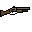
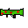
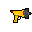
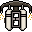

# Rapport - Projet Worms-MI4

**Groupe MI4**
*   LORIOT Baptiste (`baptiste.loriot@etu.u-paris.fr`)
*   MONA Matthys (`matthys.mona@etu.u-paris.fr`)
*   BRUNO Thomas (`thomas.bruno@etu.u-paris.fr`)
*   DENQUIN Léo (`leo.denquin-mathelot@etu.u-paris.fr`)
*   MOSCARDI Lorenzo (`lorenzo.moscardi@etu.u-paris.fr`)
*   MEYNAUD Louis (`louis.meynaud@etu.u-paris.fr`)

---

## 1. Introduction

Ce rapport détaille la conception et l'implémentation de notre projet de POO-Conduite de Projet : un clone du jeu "Worms".
Le projet a été mené en suivant la méthodologie Agile Scrum, avec des releases régulières, une intégration continue (CI/CD) stricte et une couverture de tests significative.

## 2. Architecture et Conception

Notre architecture a été pensée dès le départ pour maximiser la **modularité** et la **généricité**. Nous avons opté pour une séparation stricte des responsabilités.

### Pattern MVC (Modèle-Vue-Contrôleur)

Le projet suit rigoureusement le pattern MVC :
*   **Modèle (`com.lllmtb.model`)** : Contient uniquement les données et la logique métier (Entités, Armes...). Il est totalement indépendant de l'affichage.
*   **Vue (`com.lllmtb.ui`)** : Gère l'affichage et les entrées utilisateurs. Nous avons implémenté deux vues distinctes partageant le même modèle :
    *   Une vue graphique (`GraphicalUI`) utilisant Swing/AWT.
    *   Une vue textuelle (`ConsoleUI`) utilisant JLine3, permettant de jouer entièrement en terminal.
*   **Contrôleur (`com.lllmtb.engine`)** : Orchestre la boucle de jeu, la gestion des tours et les interactions entre le modèle et la vue.

#### Diagramme de Classes Global

```
┌─────────────────────────────────────────────────────────────────────────────────┐
│                                    ARCHITECTURE                                 │
└─────────────────────────────────────────────────────────────────────────────────┘

                                    ┌─────────────────┐
                                    │   GameEngine    │
                                    │    (Main)       │
                                    └────────┬────────┘
                                             │ crée
                         ┌───────────────────┼───────────────────┐
                         │                   │                   │
                         ▼                   ▼                   ▼
              ┌──────────────────┐  ┌──────────────────┐  ┌──────────────────┐
              │    EventBus      │  │    GameWorld     │  │       UI         │
              │   (Système)      │  │   (Controller)   │  │   (Interface)    │
              └──────────────────┘  └────────┬─────────┘  └────────┬─────────┘
                                             │                     │
                                             │                     │
                         ┌───────────────────┼                     │
                         │                   │                     │
                         ▼                   ▼                     ▼
              ┌──────────────────┐  ┌──────────────────┐  ┌───────────────────────┐
              │   PhysicsEngine  │  │   TurnManager    │  │ GraphicalUI/ConsoleUI │
              └──────────────────┘  └──────────────────┘  └───────────────────────┘

┌─────────────────────────────────────────────────────────────────────────────────────┐
│                                      MODEL                                          │
└─────────────────────────────────────────────────────────────────────────────────────┘

                                    ┌─────────────────┐
                                    │  <<abstract>>   │
                                    │     Entity      │
                                    │─────────────────│
                                    │ +uuid: int      │
                                    │ +getBody()      │
                                    │ +getCollision() │
                                    └────────┬────────┘
                                             │
               ┌─────────────────────────────┼───────────────────────────┐
               │                             │                           │
               ▼                             ▼                           ▼
      ┌─────────────────┐           ┌─────────────────┐          ┌─────────────────┐
      │      Worm       │           │  <<abstract>>   │          │      Coin       │
      │─────────────────│           │   Projectile    │          │─────────────────│
      │ +team: Team     │           │─────────────────│          │ +value: int     │
      │ +stats: Stats   │           │ +owner: Worm    │          └─────────────────┘
      │ +team: Team     │           │ +onImpact()     │
      └─────────────────┘           └─────────────────┘          ┌─────────────────┐
                                                                 │      Drop       │
                                                                 │─────────────────│
                                                                 │ +itemId: ItemId │
                                                                 └─────────────────┘
```

### 2.1 Système d'Événements

Pour découpler les composants (notamment la Vue du Modèle), nous avons implémenté un système de bus d'événements (`EventBus`).
*   **Double Bus** : Nous utilisons deux bus distincts.
    *   `systemBus` : Pour les événements globaux (Pause, Arrêt du jeu, UI).
    *   `worldBus`  : Pour les événements de gameplay de la partie en cours.
    Cette séparation permet de geler l'état du jeu (en pause) tout en continuant de traiter les entrées système (menus...).

```
┌──────────────────────────────────────────────────────────────────────────┐
│                                ÉVÈNEMENTS                                │
└──────────────────────────────────────────────────────────────────────────┘

                         ┌──────────────────────┐
                         │       EventBus       │
                         │──────────────────────│
                         │ +subscribe(type, l)  │
                         │ +postSync(event)     │
                         │ +postQueued(event)   │
                         │ +processQueued()     │
                         └──────────────────────┘

            ┌─────────────────┐            ┌─────────────────┐
            │  <<interface>>  │            │  <<interface>>  │
            │      Event      │            │  EventListener  │
            └─────────────────┘            └─────────────────┘
```

### 2.2 Pattern Command et Généricité

L'un des points forts de notre architecture est l'utilisation du pattern **Command** (`GameCommand`) combiné à un système d'items générique et modulaire.

#### Conception Modulaire des Armes et Outils
L'ajout d'une nouvelle arme ou d'un nouvel outil a été rendu extrêmement simple grâce à l'abstraction `Item` et aux registres (`WeaponRegistry`, `ToolRegistry`).

Pour ajouter une arme, il suffit de :
1. Ajouter une entrée dans l'enum `WeaponId`.
2. Créer une classe étendant `Weapon` (ex : `BazookaWeapon`).
3. Implémenter sa méthode `fire(UseParams params)` qui retourne une liste de `GameCommand`.

Exemple de simplicité d'ajout (`Bazooka`) :
```java
@Override
public List<GameCommand> fire(UseParams params) {
    // Création du projectile
    RocketProjectile rocket = new RocketProjectile(params);
    // Retourne la commande d'enregistrement de l'entité
    return List.of(new RegisterEntityCommand(rocket, params.owner));
}
```

C'est ici que réside la puissance du système : une arme n'agit pas directement sur le monde, mais elle génère des **Commandes** (`RegisterEntityCommand`, `AddPhysicsModifierCommand`...) qui seront exécutées par le moteur central au moment opportun dans le tick.
Cela garantit que toute action est "thread safe" et synchronisée avec la boucle de jeu.

Une `GameCommand` est une simple interface fonctionnelle qui agit comme un wrapper d'instructions pour le monde :
```java
@FunctionalInterface
public interface GameCommand {
    void execute(GameWorld world);
}
```
L'utilité de définir des commandes préfaites comme `RegisterEntityCommand` est de réutiliser du code commun à toutes les armes/outils, évitant ainsi la duplication. La commande gère la logique, les évènements, etc.

* Les `Projectiles` utilisent un système similaire, puisqu'ils génèrent aussi des commandes lors d'un impact (dégâts, explosions...).

### 2.3 Physique et Collisions

La physique est gérée dans un package `physics` dédié, par un moteur physique `PhysicsEngine` réalisé par nos soins.

Ce moteur est capable de gérer :
*   Les forces appliquées aux entités (projectiles, worms), et leurs déplacements.
*   La gravité, le vent, la friction au sol (forces variables selon le mode de jeu `GameMode`).
*   Les explosions et leurs effets sur le terrain et les entités.
*   Les Modifiers appliqués aux entités (ex : lenteur, parachute...).
*   Les collisions complexes via une implémentation de **Swept AABB** et **Swept Circle** inspirée de JBump.
*   Cela élimine le problème de *tunneling* (projectiles traversant les murs), et permet une meilleure estimation de la position exacte de la collision.
*   Chaque entité choisit un type de collision : elles peuvent rebondir, glisser, s'arrêter...

### 2.4 Gestion des Tours
Le système de tour par tour est géré par la classe `TurnManager`. Elle orchestre le déroulement des tours :
*   Gestion du temps par tour.
*   Changement de ver actif à la fin du temps ou sur action utilisateur (skip).
*   Interprétation des inputs utilisateur (UseInput -> Team.use etc)
*   Conditions de victoire.
*   Distribution des pièces et gestion des drops.

### 2.5 Interface Utilisateur (UI)

#### Vue Graphique (`GraphicalUI`)
*   Utilisation de **Java Swing/AWT** pour l'affichage.
*   Pour l’ambiance visuelle, nous avons réalisé des **textures** (`TextureManager`) et des **animations** (`AnimationManager`).
*   D'une part une animation *continue* pour le ver.
*   D'autre part des animations jouées *une seule fois* (`VisualEffect`), réservées aux explosions (mais code générique étendable à d’autres ajouts, comme les particules).
*   Un menu **audio** a également été implémenté, que l'on peut retrouver dans le menu principal ainsi que dans le menu pause. Il permet de gérer le choix de la musique en cours, son volume et le volume des effets sonores. À chaque arme est associé un effet sonore.
*   Les visuels et effets sonores/musiques ont été implémentés de telle sorte qu’il soit facile d’en ajouter ou d’en supprimer dans un but de modulabilité.

#### Vue Console (`ConsoleUI`)
*   Utilisation de **JLine3** pour une interface textuelle interactive.
*   Commence par un questionnaire pour configurer la partie (noms des joueurs, équipes, mode de jeu, terrain).
*   Affichage du terrain et des entités en temps réel via des caractères ASCII.
*   Interaction via le clavier (touches fléchées, lettres) pour se déplacer, sélectionner un item, l'utiliser...
*   Affichage des informations de jeu (stats des worms, inventaire, tour en cours) dans des panneaux dédiés.

### 2.6 Persistance et Sauvegarde
La gestion de la sauvegarde est gérée par la classe statique `Save` à partir d'une classe conteneur `GameSave`:
*   Utilisation de la **Gson** pour la sérialisation de l'instance de `GameSave` à sauvegarder.
*   Commence par transformer une instance de `GameWorld` en `GameSave`
*   Sérialise l'instance de `GameSave` pour le transformer en un String.
*   Sauvegarde ce String dans un fichier json à part.
*   La map est, quant à elle, sauvegardé dans un fichier textuel à part.

## 3. Fonctionnalités Implémentées

Le cahier des charges a été entièrement respecté et enrichi de nombreuses extensions.

### 3.1 Cœur du Jeu
*   **Terrain Destructible** : Génération procédurale avec différents biomes, ou chargement depuis un fichier.
*   **Physique** : Gravité, Vent, Friction, Rebond.
*   **Tour par Tour** : Gestion précise du temps, changement de ver, inventaire d'équipe partagé.
à compléter avec la v1 du rapport

### 3.2 Arsenal (Armes et Outils)
Chaque Team (joueur) est dotée d'un inventaire d'armes et d'outils.
Au début de la partie, chaque joueur reçoit les deux armes de base : le pistolet avec des munitions en nombre infini, et la batte.
Il pourra par la suite acquérir différentes armes et objets moyennant un achat via la boutique. En voici une liste exhaustive :

**Armes :**

| Image                                                              | Nom et ID                                      | Description                                                                                                   |
|--------------------------------------------------------------------|------------------------------------------------|---------------------------------------------------------------------------------------------------------------|
|             | **Pistolet** *(GUN)*                           | Arme de poing.                                                                                                |
|     | **Batte** *(BASEBALLBAT)*                      | Arme de corps à corps.                                                                                        |
|         | **Lance-roquette** *(BAZOOKA)*                 | Arme tirant un projectile explosif.                                                                           |
|             | **Arc** *(BOW)*                                | Tire des flèches plus ou moins fortement et inflige plus ou moins de dégâts en fonction du temps de clic.     |
|         | **Fusil à pompe** *(SHOTGUN)*                  | A la spécificité de tirer plusieurs projectiles à la fois, très utile à courte portée.                        |
|          | **Canon à gaz** *(GASGUN)*                     | Tire un projectile imposant qui aura pour effet d’infliger un effet de poison à tous les vers le rencontrant. |
|  | **Lance-roquette soignant** *(HEALINGBAZOOKA)* | Version du lance-roquette originel redonnant de la vie et annulant les effets en cours.                       |
|   | **Canon à électrons** *(ELECTRONCANON)*        | Arme « de ricochet » au sens où son projectile rebondit d’ennemi en ennemi.                                   |


**Outils :**

| Image                                                       | Nom et ID                          | Description                                                                                                                                                                |
|-------------------------------------------------------------|------------------------------------|----------------------------------------------------------------------------------------------------------------------------------------------------------------------------|
|       | **Kit de soin** *(MEDKIT)*         | Outil de soin, qui a pour effet de redonner de la vie au ver qui l’utilise et d’annuler les effets malus en cours.                                                         |
|      | **Grenade** *(GRENADE)*            | Projectile à retardement, explosif et rebondissant.                                                                                                                        |
|         | **Mine** *(MINE)*                  | Piège qui explose quand une entité entre en contact.                                                                                                                       |
|        | **Tourelle** *(TOWER)*             | Outil défensif visant automatiquement l’ennemi dont le tour est en cours dans un rayon restreint. Elle reste active durant un tour entier.                                 |
|    | **Parachute** *(PARACHUTE)*        | Outil de mobilité permettant de ralentir la chute.                                                                                                                         |
|      | **Jetpack** *(JETPACK)*            | Outil de mobilité permettant de voler à sa guise avec un carburant limité.                                                                                                 |
|         | **Piège** *(TRAP)*                 | Outil posable au sol qui à son contact inflige des dégâts et un effet de poison.                                                                                           |
|  | **Chat de béton** *(CATCONCRETE)*  | Fait office d’outil de terrain. A l’image de l’âne de béton dans le jeu originel, le chat de ciment permet de creuser un trou vertical facilitant la création de galeries. |
|   | **Frappe aérienne** *(CALLSTRIKE)* | Outil permettant de tirer un projectile explosif puissant quelque soit notre position sur la carte.                                                                        |


### 3.3 Fonctionnalités Avancées
*   **Modes de Jeu** : Normal, Moon (gravité faible), Ice Age (terrain glissant).
*   **Économie** : Système de *Coins* (pièces) récoltables sur la carte ou gagnés par tour.
*   **Boutique (Shop)** : Achat d'armes, de munitions et d'outils via une interface dédiée.
*   **Colis (Drops)** : Largage aléatoire de caisses contenant des bonus.
*   **Montée des eaux** : *Sudden Death*, l'eau monte progressivement en fin de partie.
*   **Sauvegarde Complète** : Sérialisation JSON (`GSON`) complète de l'état du jeu (entités, map, tours) permettant une reprise exacte.

## 4. Méthodologie, Qualité et Tests

### 4.1 Gestion de Projet et Git
Le projet a suivi le workflow **Git Flow** :
*   Branches `feature/[feature]` ou `[package]/[feature]` pour chaque développement, `fix/[fix]` pour les corrections de bug.
*   Merge Requests (MR) dans dev obligatoires avec revue de code par au moins trois autres membres.
*   Branche `dev` pour l'intégration des sprints.
*   Branche `main` uniquement pour les releases stables (MR unique dev -> main).

**Répartition des rôles Scrum :**

|            | Scrum Master | Product Owner |
|------------|--------------|---------------|
| Sprint n°1 | Baptiste     | Tout le monde |
| Sprint n°2 | Matthys      | Lorenzo       |
| Sprint n°3 | Lorenzo      | Matthys & Léo |
| Sprint n°4 | Louis        | Thomas        |

**Répartition du travail au sein du projet (en %) :**

- *Léo* • 19
- *Baptiste* • 18
- *Matthys* • 17
- *Thomas* • 16
- *Louis* • 16
- *Lorenzo* • 14


### 4.2 Intégration Continue (CI/CD)
Une pipeline GitLab CI complète a été mise en place (.gitlab-ci.yml) :
1.  **Validate** : Vérification du style de code via **Checkstyle** selon des règles inspirées des conventions Sun. Un **hook pré-commit** Checkstyle a été mis en place.
2.  **Compile** : Vérification de la compilation Maven.
3.  **Test** : Exécution des tests unitaires et d'intégration. Utilisation de **JaCoCo** pour vérifier la couverture de code (seuil minimal imposé).
    * La pipeline délivre un artéfact contenant un fichier html avec le rapport de couverture, ainsi que le rapport XML pour l’intégration dans GitLab.
    * Lors du sprint 1, le seuil de couverture était élevé avec 90% de lignes et branches testées. Par la suite, il fut abaissé à 75%.
4.  **Package** : Génération automatique des artéfacts (JAR exécutable) et upload sur GitLab en cas de succès.

NB. Après les mises à jour GitLab de Noël, une limite de taille a été imposée à l'upload d'artéfacts. Cette fonctionnalité a donc été temporairement désactivée.


En cette période de fêtes, Ginette, le runner GitLab de l’université, peinait à exécuter nos pipelines. De ce fait, la solution qui a été prise fut la suivante : rajouter deux runners personnels au projet (*le remplaçant de Ginette* et *Fred*). Depuis, nos pipelines sont quasiment instantanées.

### 4.3 Stratégie de Tests
*   **Tests Unitaires** : Utilisation de **JUnit 5** et **Mockito** pour tester isolément la logique métier (ex: calculs de vecteurs, gestion d'inventaire).
*   **Tests d'Intégration** : Tests end-to-end (`GameWorldTest`) simulants une partie complète (chargement de map, initialisation physique, tours) pour garantir la cohérence globale.
*   **Tests de Robustesse** : Validation stricte des entrées (chargement de fichiers corrompus, paramètres invalides) et gestion des exceptions pour éviter les crashs.
*   * Utilisation du **fuzzing** pour vérifier la robustesse du chargeur de map face à des entrées aléatoires.
*   **Tests de Performance** : Monitoring de la durée des "ticks" (boucle de jeu) pour assurer un framerate fluide (120Hz visé) même avec beaucoup de particules.

### TESTÉ SUR:
- WINDOWS 11
- DEBIAN 13
- UBUNTU 22.04
- ARCH 6.18
- MACOS VENTURA

## 5. Problèmes Rencontrés et Solutions

1.  Durant le Sprint n°1, nous avons été confrontés à des **problèmes de dépendance** les uns aux autres.
    *   Ce problème n’a pas refait surface durant la suite du projet dû à notre avancée, qui nous a permis de travailler plus indépendamment.
2.  Durant le Sprint n°2, l’ajout du menu pause nous a mis face à un problème : la gestion des évènements se faisait à un seul niveau. Ainsi lors de la mise en pause du jeu, il nous était impossible de reprendre la partie ou de faire quelconque action du fait que les événements postés n’étaient pas interprétés (bus mis en pause).
    *   *Solution* : Introduction d’une gestion des évènements à double-niveau (système/jeu). Avec cette solution, les évènements du jeu ne sont pas interprétés lors de la mise en pause du jeu, mais les événements du système si. 
3. **Tunneling (Physique)** : Les projectiles rapides traversaient parfois les murs, et lors des collisions, les worms étaient téléportés.
    *   *Solution* : Implémentation des collisions par balayage (**Swept Collision**) calculant le temps exact d'impact ($t_i$) intra-frame.
    *   Pour trouver la source du problème, nous avons utilisé la technique du Printf Debugging en plaçant des flags, pour vérifier si une fonction est bien exécutée, des « dumps », pour vérifier le contenu de certaines variables, ou encore des traces pour suivre l’évolution d’une variable au fil du temps. Une fois la coquille identifiée, sa résolution s’est révélée plus simple que prévu.
4.  **Concurrency** : Modifications concurrentes des listes d'entités (GameLoop vs UI).
    *   *Solution* : Utilisation de collections thread-safe (`CopyOnWriteArrayList`) et du pattern Command pour différer les modifications structurelles au début du tick suivant.
5.  **Sérialisation** : Boucles infinies lors de la sauvegarde JSON (Worm <-> Team).
    *   *Solution* : Utilisation de champs `transient` et reconstruction des liens cycliques au chargement (`Load.postProcess`).

## 6. Pistes d'Extension

Avec davantage de temps, nous aurions aimé implémenter davantage de fonctionnalités.
Grâce à la modularité du code, plusieurs extensions sont envisageables :
*   **Multijoueur Réseau** : L'utilisation de Commandes sérialisables faciliterait grandement la synchronisation client-serveur.
*   **IA Avancée** : Les bots actuels pourraient utiliser des algorithmes de recherche de chemin sur la matrice du terrain.
*   **Nouveaux Armes et Outils** : Le système de registre permet d'ajouter facilement de nouvelles armes (ex: lance-flammes, sniper) et outils (ex: grappin, bouclier).
*   **Véhicules** : Ajout de véhicules pilotables (jeep, hélicoptère) avec physique dédiée, à la manière du Jetpack.
*   **Système de craft** : Nous aurions pu donner de temps à autre des matériaux aux joueurs, stockés dans leur inventaire. Puis dans une interface, à l’instar de la boutique avec les pièces, ils pourraient échanger les matériaux pour « fabriquer » des armes ou des munitions.

* De plus, d'autres idées nous sont venues en tête. Nous avons notamment pensé à ajouter des modes de jeu type « Battle Royale » ou « Roi de la colline ». Ces ajouts auraient demandé peut-être davantage de modifications de l’implémentation actuelle des modes de jeu.

## 7. Bibliothèques Utilisées

*   **GSON** : Persistance des données (JSON).
*   **JLine3** : Gestion de l'interface console avancée.
*   **Log4j2** : Système de logging performant.
*   **JUnit 5** : Tests unitaires.
*   **Mockito** : Mocking pour les tests.
*   **JaCoCo** : Couverture de code.
*   **Checkstyle** : Lint & validate.
*   **Maven Assembly** : Package en fat jar.
