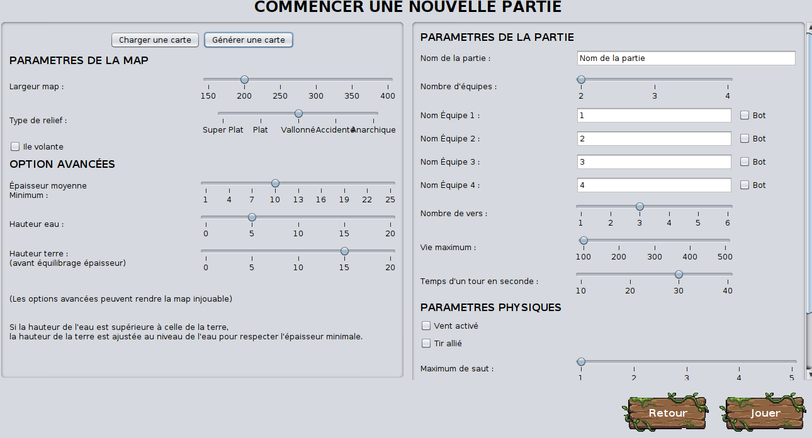
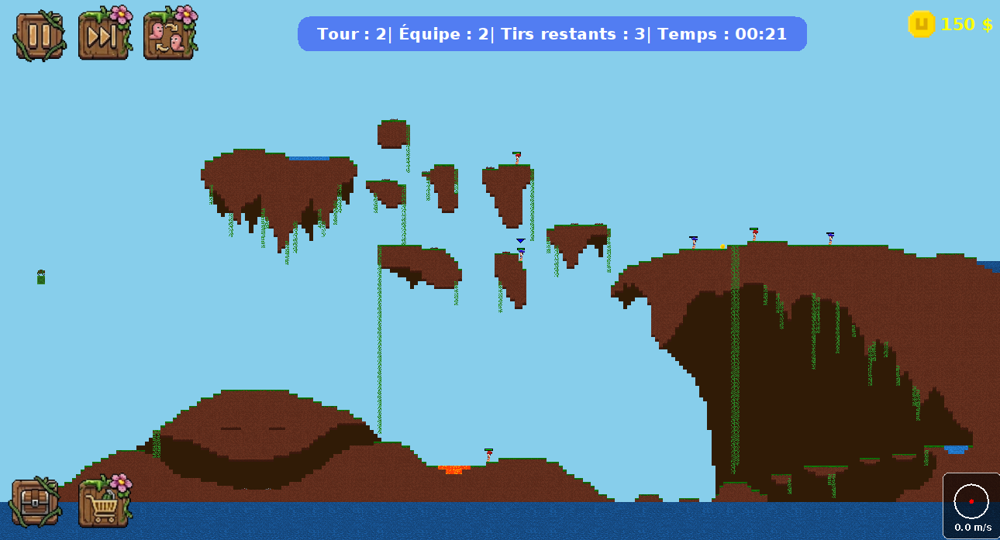
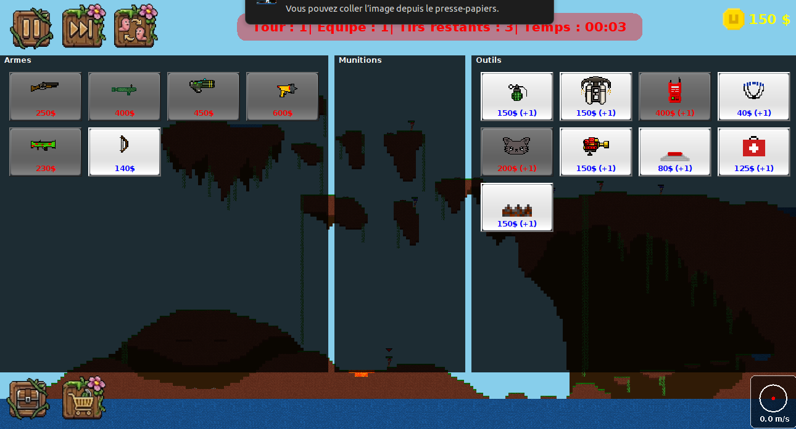

# Worms MI4 - Clone de Worms en Java


*Projet universitaire de L2 Informatique (Double Licence Maths-Info). Validé avec la note de 20/20.*
  




## Présentation du jeu

Worms MI4 est un clone complet du célèbre jeu de stratégie au tour par tour *Worms*. Le jeu met en scène des affrontements d'équipes de vers de terre sur des cartes destructibles. L'objectif est d'être la dernière équipe en vie en utilisant un vaste arsenal d'armes (bazooka, fusil à pompe, canon à électrons) et d'outils (jetpack, parachute, tourelle).

**Fonctionnalités principales :**
* **Terrain destructible** et génération procédurale.
* **Moteur physique complet créé sur mesure** (gravité, vent, collisions).
* **IA ennemie** (bots) et mode multijoueur local.
* **Système de montée des eaux**.
* Interface hybride : Jouable en **mode Graphique** (Swing) ou en **mode Console** (JLine3).

---

## Architecture & Conception technique

Ce projet a été conçu avec une architecture logicielle rigoureuse, pensée pour la modularité et les performances.

### Modèle-Vue-Contrôleur (MVC) & EventBus
L'architecture sépare strictement la logique métier de l'affichage. La communication entre ces couches est assurée par un **EventBus asynchrone à double niveau** (un bus pour les événements système, un bus pour le gameplay). Cela permet un faible couplage et une gestion de la pause parfaite.

### Pattern Command & Registres d'objets
Toute la logique d'utilisation des armes et outils repose sur le Pattern Command (`GameCommand`).
Lorsqu'une arme est utilisée, elle ne modifie pas directement le monde, mais génère une file de commandes qui seront exécutées de manière *thread-safe* lors du prochain tick du moteur de jeu. L'ajout de nouvelles armes est rendu extrêmement simple grâce à des `WeaponRegistry` et `ToolRegistry`.

### Persistance des données (DTO)
Le système de sauvegarde utilise le pattern **Data Transfer Object (DTO)** couplé à une sérialisation **JSON** via `Gson`. L'état complexe du `GameWorld` est mappé dans une structure de données primaires (`GameSave`), garantissant des sauvegardes légères et exemptes de boucles infinies.

---

## Installation et Lancement

### Lancer le jeu immédiatement

Vous pouvez jouer tout de suite sans avoir à compiler le code. Assurez-vous d'avoir **Java 17** (ou supérieur).

**[Télécharger le jeu](https://github.com/LouisMeynaud/Projet_L2_Worms/releases/download/v2.0/worms-2.0-fat.jar)** 

Une fois téléchargé, lancez-le via votre terminal :
* **En mode Graphique :**
  ```bash
  java -jar worms-2.0-fat.jar
  ```
* **En mode Console (Terminal) :**
  ```bash
  java -jar worms-2.0-fat.jar console
  ```

### Compiler depuis le code source (Maven)

```bash
git clone https://github.com/LouisMeynaud/Projet_L2_Worms.git
cd worms-mi4
mvn clean package
```
L'exécutable se trouvera dans le dossier `target/` sous le nom `worms-2.0-fat.jar`.

---

## L'Équipe et mes contributions

Ce projet a été réalisé en méthode Agile Scrum par un groupe de 6 étudiants : Baptiste LORIOT, Matthys MONA, Thomas BRUNO, Léo DENQUIN, Lorenzo MOSCARDI et **Louis MEYNAUD**.

**Mes contributions spécifiques sur le projet :**
* Implémentation du système de collisionsau sein du moteur physique
* Implémentation des objets *inventory*, *tool* et *weapon*
* Implémentation des altérations de statut
* Création et ajout d'une map
* Création et ajout de certains outils et armes
* Création et ajout du model de drop

---

## Licence
Ce projet est sous licence MIT (voir le fichier [LICENSE](LICENSE) pour plus de détails).